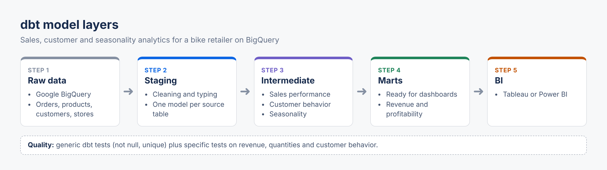

# LocalBike Project

> 🇬🇧 **English summary:** dbt project for a bike retailer: complete analysis of sales data, customer behavior and commercial trends, modeled into staging, intermediate and mart layers.



LocalBike Project est une analyse complète des données commerciales d'une entreprise spécialisée dans la vente de vélos et accessoires. Ce projet exploite **DBT (Data Build Tool)** pour transformer, structurer et modéliser les données, tout en fournissant des insights exploitables pour soutenir les décisions stratégiques.

---

## 🚀 **Objectifs**

### 1. Maximiser les revenus :
- Identifier les opportunités de croissance.
- Optimiser les opérations existantes.

### 2. Fidéliser les clients :
- Analyser le comportement d'achat pour des campagnes ciblées.
- Capturer de nouveaux marchés.

### 3. Améliorer la gestion des stocks :
- Identifier les tendances saisonnières pour anticiper les périodes creuses et les pics de vente.

---

## 📊 **Axes d'Analyse**

### **1. Performance des Ventes**
- Analyse des revenus par point de vente (Santa Cruz, Baldwin, Rowlett).
- Identification des produits les plus vendus par catégorie (vélos urbains, VTT, accessoires).
- Segmentation des ventes par canal (boutique physique, en ligne).

### **2. Comportement Client**
- Fréquence et récurrence des achats pour évaluer la fidélisation.
- Catégorisation des clients par localisation pour des campagnes marketing ciblées.
- Analyse des comportements d'achat dans chaque localisation (ville, état, code postal).

### **3. Saisonnalité et Tendances**
- Identification des pics de ventes et périodes creuses.
- Planification optimale des promotions et des stocks.

### **4. Analyse de la Rentabilité**
- Revenus totaux par produit.
- Quantités totales vendues.
- Contribution au revenu global (en pourcentage).

---

## 🛠️ **Technologies Utilisées**

- **DBT (Data Build Tool)** : Transformation et modélisation des données.
- **Entrepôt de données** : Google BigQuery.
- **Versionnement** : GitHub pour la gestion des versions.
- **Visualisation** : Compatible avec Tableau ou Power BI.


---

## 🔍 **Modèles DBT**

### **1. Staging**
Les modèles de staging nettoient et préparent les données brutes pour leur utilisation dans les analyses.

### **2. Intermediate**
Les modèles intermédiaires intègrent les transformations complexes et répondent aux axes d'analyse prioritaires :
- Performance des ventes.
- Comportement client.
- Saisonnalité et tendances.

### **3. Marts**
Les marts synthétisent les résultats des modèles intermédiaires pour la consommation dans les tableaux de bord ou rapports.

---

## ✅ **Tests**

Des tests sont inclus pour garantir l'intégrité des données :
- Tests génériques (non-null, unique, etc.).
- Tests spécifiques pour valider les revenus, quantités vendues, et comportements clients.

---

## 📦 **Installation et Exécution**

### **1. Clonez le dépôt**
```bash
git clone https://github.com/GhntSergio/Local_bike_project.git
cd Local_bike_project

---


